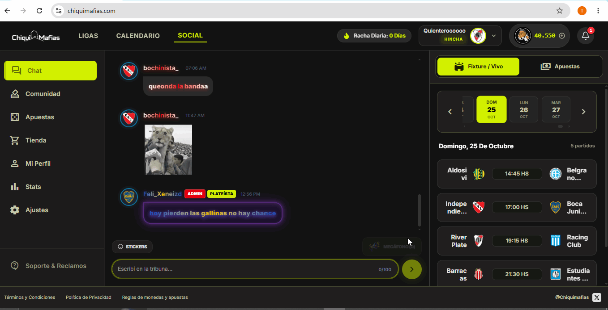
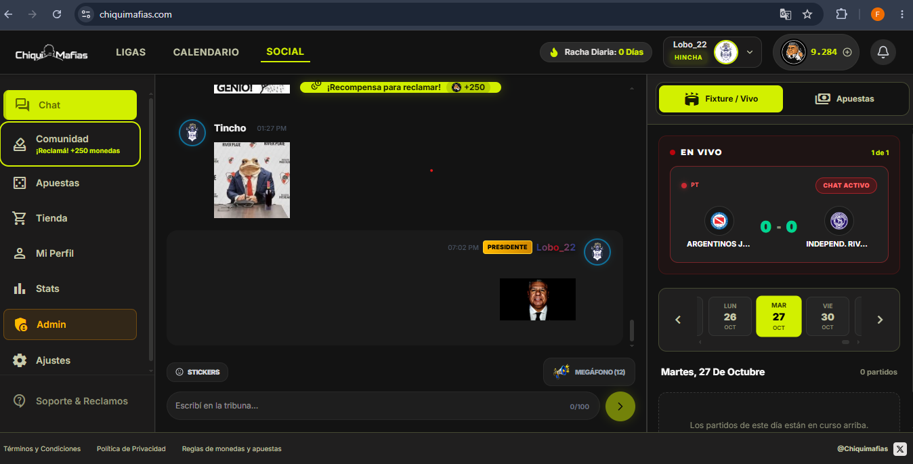
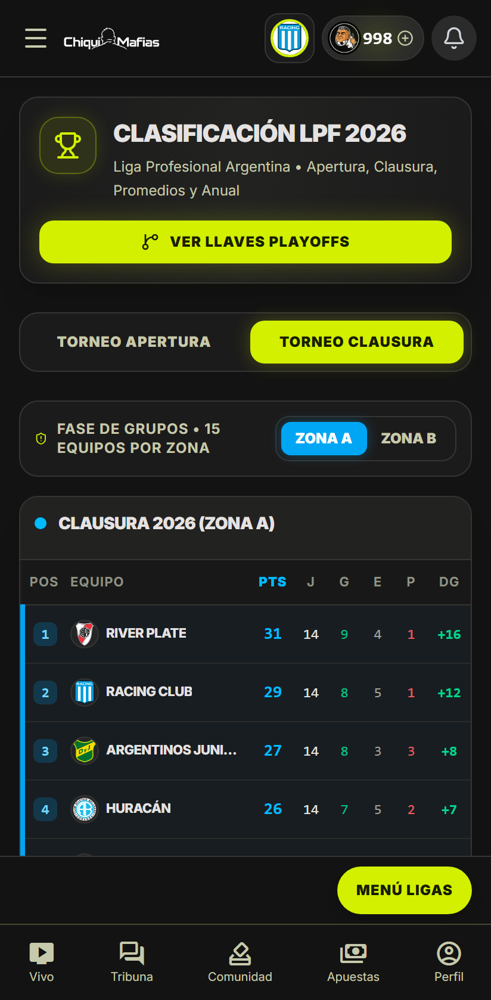
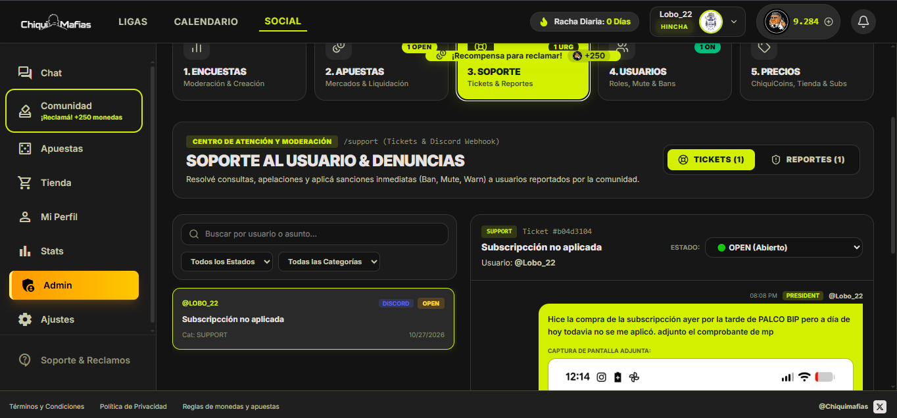
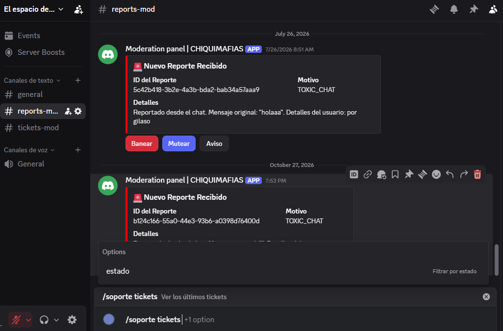
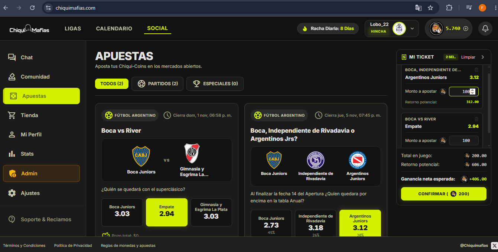
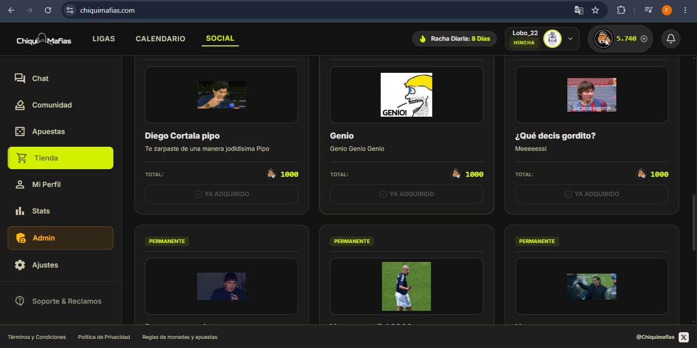
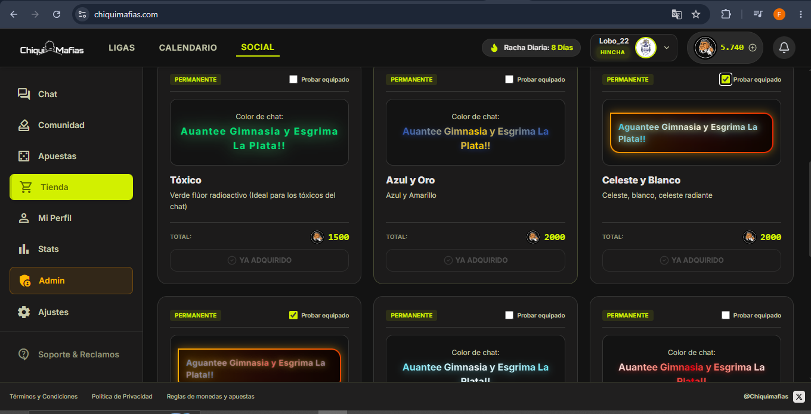
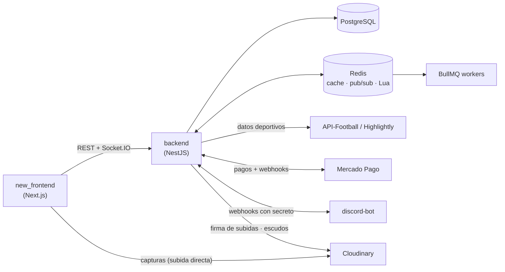

# ChiquiMafias ⚽

**Plataforma de fútbol argentino en tiempo real con comunidad, apuestas virtuales y economía propia.**

[](https://github.com/TorricoFranco/ChiquiMafias/actions/workflows/pipeline.yml)
[](https://github.com/TorricoFranco/ChiquiMafias/actions/workflows/frontend.yml)


<p align="center">
  
</p>

## ¿Qué es?

La mayoría de las apps de fútbol (Promiedos, Canchallena, etc.) son hojas de cálculo
estáticas: resultados y tablas, y nada más. ChiquiMafias combina esos datos en vivo con
**comunidad**: chat global y por partido, encuestas, apuestas virtuales entre usuarios y
una economía de monedas para destacarse con cosméticos.

Está pensada para dos perfiles: el **hincha que consume datos** (resultados, formaciones,
estadísticas y tabla de la liga argentina en tiempo real) y el **miembro de la
comunidad**, que chatea, vota, apuesta y personaliza su perfil.

## Funcionalidades

- **Partidos en vivo**: marcador, eventos, formaciones y estadísticas que se actualizan
  solos por WebSocket.
- **Tabla, fixture y playoffs** de la liga argentina.
- **Chat** global y una sala por partido, con stickers, mensajes fijados ("megáfono")
  y moderación en tiempo real: el staff borra mensajes y silencia usuarios.
- **Apuestas virtuales pari-mutuel**: el pozo se reparte entre los que acertaron, con
  las cuotas actualizándose en vivo.
- **Encuestas**: los usuarios las proponen con un ticket de la tienda, un moderador las
  aprueba y el staff puede publicar encuestas oficiales.
- **Economía de monedas**: racha diaria, tienda de cosméticos, megáfonos y packs de
  monedas con Mercado Pago.
- **Suscripciones** con Mercado Pago en tres niveles: Popular, Plateísta y Palco VIP.
- **Roles y panel de administración** para moderar la comunidad, con permisos por rango.
- **Soporte y moderación** desde el panel web y desde Discord, sincronizados.

## Capturas

<table>
  <tr>
    <td align="center" width="50%">
      <br>
      <sub><b>Social en desktop</b>: chat, partido en vivo y navegación</sub>
    </td>
    <td align="center" width="50%">
      <br>
      <sub><b>Clasificación en mobile</b>: el mismo producto, pensado para el celular</sub>
    </td>
  </tr>
  <tr>
    <td align="center" width="50%">
      <br>
      <sub><b>Panel de administración</b>: soporte y moderación según el rol</sub>
    </td>
    <td align="center" width="50%">
      <br>
      <sub><b>Moderación en Discord</b>: reportes con botones de acción</sub>
    </td>
  </tr>
</table>

## Roles y permisos

Los roles tienen jerarquía: **Hincha < Jefe de barra < Admin < Presidente**. Cada nivel incluye lo del anterior. Nadie puede sancionar ni cambiar el rol de alguien de su mismo rango o superior, ni asignar un rol mayor al propio.

| Rol | Qué puede hacer |
|---|---|
| **Hincha** | Chatear, votar, proponer encuestas, apostar, comprar en la tienda y reportar a otros usuarios. |
| **Jefe de barra** (moderador) | Borrar mensajes del chat y silenciar en el chat, aprobar o rechazar encuestas, crear encuestas oficiales, atender tickets y resolver reportes: aviso (a cualquiera), silencio temporal o ban (solo a usuarios de menor rango). |
| **Admin** | Todo lo anterior, más: crear y liquidar mercados de apuestas, enviar anuncios y notificaciones, y gestionar la tienda y los packs (sin tocar precios). |
| **Presidente** | Todo lo anterior, más: definir los precios (cada cambio queda auditado), crear ítems y campañas de descuento, crear packs, dar monedas a un usuario y cargar o corregir el cuadro de playoffs. |

### Panel de administración

Aparece en la barra lateral para jefes de barra, admins y presidente. Las pestañas que no corresponden al rol se muestran bloqueadas.

| Pestaña | Acceso | Qué hace |
|---|---|---|
| Encuestas | Jefe de barra+ | Aprobar o rechazar propuestas, crear encuestas oficiales y cerrar las activas |
| Soporte | Jefe de barra+ | Atender tickets (con capturas) y resolver reportes |
| Apuestas | Admin+ | Crear mercados y liquidarlos |
| Usuarios | Admin+ | Roles, silencios y bans |
| Precios | Presidente | Precios de monedas, tienda y suscripciones |

## Soporte y moderación desde Discord

Los tickets y reportes también llegan a un servidor de Discord de los admins:

- **Tickets**: cada ticket abre un hilo. Lo que escribe el staff en el hilo, con adjuntos, le llega al usuario en la web, y un menú cambia el estado (abierto, en revisión, resuelto o cerrado).
- **Reportes**: cada denuncia llega como alerta con los botones **Aviso**, **Mutear** (pide motivo y horas) y **Banear** (pide motivo).
- **Comandos**: `/soporte tickets` y `/soporte reportes`.

El bot es un microservicio aparte, sin estado propio: todo pasa por webhooks autenticados con un secreto compartido, y PostgreSQL es la única fuente de verdad. Desde Discord solo se sanciona a usuarios; al staff se lo sanciona desde el panel web y con rango superior.

## Economía: monedas y suscripciones

- **Packs de monedas (ChiquiCoins)**: compra única con Mercado Pago. Los pagos llegan por webhook y son idempotentes: una unique constraint evita acreditar dos veces el mismo pago.
- **Tienda**: ítems permanentes (stickers, banners, colores de nombre, burbujas de chat) y consumibles (megáfonos para fijar mensajes y tickets para proponer encuestas). Lo comprado queda en el inventario.
- **Suscripciones**: tres niveles (Popular, Plateísta y Palco VIP) con cobro recurrente en Mercado Pago. Suben el multiplicador de la racha diaria (hasta x2), los upgrades se prorratean, hay período de gracia si falla un cobro y un cron de conciliación cubre los webhooks que no llegan.
- **Racha diaria**: recompensa que crece con los días seguidos, con regalos cosméticos en los días 5, 7, 10, 15, 20, 25 y 30.

Así se ven las apuestas y la tienda:

<table>
  <tr>
    <td align="center" width="33%">
      <br>
      <sub><b>Apuestas</b>: mercados abiertos y ticket con retorno potencial</sub>
    </td>
    <td align="center" width="33%">
      <br>
      <sub><b>Tienda</b>: stickers para el chat</sub>
    </td>
    <td align="center" width="33%">
      <br>
      <sub><b>Tienda</b>: colores de chat, con vista previa</sub>
    </td>
  </tr>
</table>

## Stack

| App | Tecnologías |
|---|---|
| **Backend** (`backend/`) | NestJS 11, Prisma 6 + PostgreSQL 15, Redis 7, BullMQ, Socket.IO, JWT + Google OAuth, Swagger |
| **Frontend** (`new_frontend/`) | Next.js 16 (App Router), React 19, TanStack Query, Zustand, Tailwind CSS 4, socket.io-client |
| **Bot** (`discord-bot/`) | Express 5, discord.js 14 |
| **Integraciones** | API-Football o Highlightly (datos deportivos), Mercado Pago, Cloudinary, Discord, Resend, Cloudflare R2 (backups) |
| **Infra y calidad** | Docker Compose, Caddy (HTTPS automático), Ubuntu en VPS, GitHub Actions, Jest, Supertest, Playwright |

## Arquitectura



El backend es la única fuente de verdad. Los crons traen los datos deportivos (API-Football
o Highlightly, según `FOOTBALL_PROVIDER`) y los publican en Redis, y los gateways de
Socket.IO los re-emiten a los clientes. El detalle completo está en
**[docs/ARCHITECTURE.md](docs/ARCHITECTURE.md)**.

### Highlights técnicos

- **Apuestas atómicas en Redis con Lua** y persistencia diferida con BullMQ
  (write-behind): respuesta en milisegundos aunque lleguen cientos de apuestas en el
  último minuto. → [detalle](docs/ARCHITECTURE.md#apuestas-de-alta-concurrencia-con-lua-y-write-behind)
- **Wallet sin doble gasto** con updates condicionales y locks optimistas dentro de
  transacciones. → [detalle](docs/ARCHITECTURE.md#consistencia-financiera-sin-doble-gasto)
- **Webhooks de pago idempotentes**: una unique constraint garantiza que un pago
  reintentado no acredite dos veces. → [detalle](docs/ARCHITECTURE.md#webhooks-idempotentes-de-mercado-pago)
- **Tiempo real desacoplado** con pub/sub de Redis entre la ingesta y los gateways.
  → [detalle](docs/ARCHITECTURE.md#tiempo-real-desacoplado-con-redis-pubsub)
- **Cache-aside** para no agotar la cuota de la API deportiva y tolerar sus caídas.
  → [detalle](docs/ARCHITECTURE.md#cache-aside-frente-a-api-football)
- **Backoffice en Discord**: un microservicio aparte con contrato de webhooks
  autenticado en los dos sentidos. → [detalle](docs/ARCHITECTURE.md#backoffice-en-discord)
- **Permisos en capas**: jerarquía de roles validada en un guard, sanciones solo hacia
  rangos inferiores y precios que cambian únicamente desde un endpoint auditado.
- **Subida firmada a Cloudinary**: el navegador sube la captura con una firma que genera
  el backend (el secreto nunca sale del servidor), y el backend solo acepta URLs de
  Cloudinary al guardar el ticket.
- **Proveedor de datos intercambiable**: API-Football y Highlightly detrás del mismo
  contrato, elegido con una variable de entorno.
- **Producción endurecida**: un solo puerto público, base y Redis en red interna, y backups diarios cifrados fuera del servidor. → [guía de despliegue](docs/DEPLOY.md)

## Cómo levantarlo

Requisitos: Docker y Docker Compose v2.

```bash
git clone https://github.com/TorricoFranco/ChiquiMafias.git
cd ChiquiMafias
cp .env.example .env.dev   # completar credenciales

docker compose --env-file .env.dev -f docker-compose.dev.yml up -d postgres redis
docker compose --env-file .env.dev -f docker-compose.dev.yml run --rm backend npx prisma migrate deploy
docker compose --env-file .env.dev -f docker-compose.dev.yml up
```

Web en <http://localhost:3005> y Swagger en <http://localhost:3007/api>.

Las credenciales necesarias, cómo correr las apps sin Docker, los datos iniciales y los
problemas comunes están en **[docs/SETUP.md](docs/SETUP.md)**.

## Producción en un VPS

El sitio corre en producción en un VPS propio con Ubuntu y Docker Compose, en [chiquimafias.com](https://chiquimafias.com). Algunas decisiones de la configuración:

- **Un solo puerto de entrada:** Caddy es el único servicio que publica puertos (80 y 443). Postgres y Redis viven en una red interna sin salida a internet, y ningún otro contenedor publica puertos.
- **HTTPS automático:** Caddy pide y renueva los certificados de Let's Encrypt, con HSTS y headers de seguridad. `www` redirige al dominio principal.
- **Servidor endurecido con un script:** SSH solo con llave y sin root, firewall UFW (solo SSH, 80 y 443), fail2ban, actualizaciones automáticas y swap.
- **Migraciones al arrancar:** el backend aplica `prisma migrate deploy` antes de levantar.
- **Límites y logs:** cada contenedor tiene su límite de memoria, y los logs rotan.
- **Backups:** todos los días a las 03:30 se vuelca Postgres y Redis, se verifica el archivo y se rota (7 diarios, 4 semanales y 6 mensuales). Después se sube cifrado a Cloudflare R2, fuera del servidor. Hay script de restauración y el rollback de código y base está documentado.
- **Auditoría desde afuera:** un script revisa que solo estén abiertos SSH, 80 y 443, que HTTP redirija a HTTPS y que Swagger y el login de desarrollo no existan.

La guía completa, con los pasos del servidor, está en [docs/DEPLOY.md](docs/DEPLOY.md).

## Estructura del monorepo

| Carpeta | Qué es |
|---|---|
| [`backend/`](backend/) | API REST + WebSockets, crons y colas |
| [`new_frontend/`](new_frontend/) | Aplicación web (frontend activo) |
| [`discord-bot/`](discord-bot/) | Microservicio de soporte y moderación |
| [`docs/`](docs/) | Arquitectura, instalación y capturas |
| `.claude/` | Configuración del desarrollo asistido por IA (ver abajo) |

## Tests y CI

- **Backend**: unit tests con Jest de la lógica crítica (liquidación de mercados,
  idempotencia de webhooks y rachas) y e2e con Supertest contra Postgres y Redis
  reales. CI: [`pipeline.yml`](.github/workflows/pipeline.yml) en cada push o PR a
  `main`.
- **Frontend**: suite e2e de Playwright con la API y los sockets mockeados, en desktop
  y mobile, contra el build de producción. CI: [`frontend.yml`](.github/workflows/frontend.yml)
  en cada push o PR a `develop` y `main`.
- **Deploy:** el CI no despliega. El deploy se hace a mano en el VPS: backup previo, `git pull` de `main` y `docker compose up -d --build`. El procedimiento completo está en [docs/DEPLOY.md](docs/DEPLOY.md).

## Desarrollo asistido por IA

No es "le pedí a una IA que lo haga": el proyecto se desarrolla con [Claude Code](https://claude.com/claude-code) y un **flujo de trabajo versionado en el repo** (`.claude/`) para que la IA sea predecible, barata y esté bajo control.

| Práctica | Cómo se aplica acá |
|---|---|
| 🧭 **Contexto por app** | Un `CLAUDE.md` en la raíz y uno por app (backend, frontend, bot): comandos, convenciones y trampas conocidas. La IA no tiene que redescubrir el proyecto en cada sesión. |
| 💸 **Cuidado de tokens** | 9 *rules* con `paths`: solo se cargan al tocar su zona (p. ej. las reglas de dinero únicamente en `wallet/`, `bets/` o `webhook/`). Contexto mínimo, respuestas más precisas. |
| 🛠️ **Skills propias** | `/nest-module`, `/frontend-feature`, `/verificar` y `/finalizar-feature` automatizan scaffolding, verificación (build + lint + tests) y cierre de PRs con la convención del equipo. |
| 🕵️ **Subagentes revisores** | `backend-reviewer` (dinero, concurrencia, auth), `frontend-reviewer` y `contract-checker` (detecta desfases entre backend, frontend y bot). Son de solo lectura y **recuerdan los bugs recurrentes** entre sesiones. |
| 🔒 **Permisos y guardrails** | Lista `allow / ask / deny`: lint, build y unit tests corren solos; `git push`, migraciones y e2e piden confirmación; `.env`, `force push`, `migrate reset` y el frontend legacy están **bloqueados**. |
| ✅ **Humano en el loop** | Nada se da por listo sin verificar. Los cambios en dinero requieren plan previo y revisión; `main` es 100 % manual y cada commit se confirma antes de crearse. |

El resultado es un historial de PRs chicas con commits convencionales, tests en verde y cambios sensibles revisados dos veces: por un agente especializado y por una persona.

## Licencia

© 2026 Franco Torrico. Todos los derechos reservados: el código es visible con fines de
portfolio, pero no está licenciado para uso, copia ni redistribución. Ver
[LICENSE](LICENSE).
